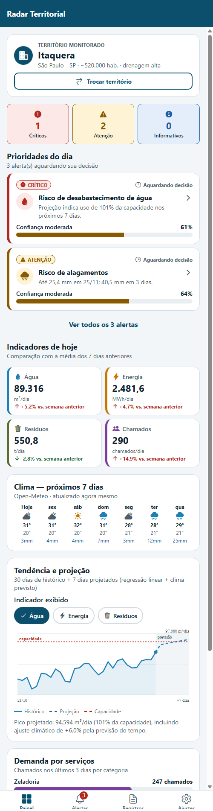
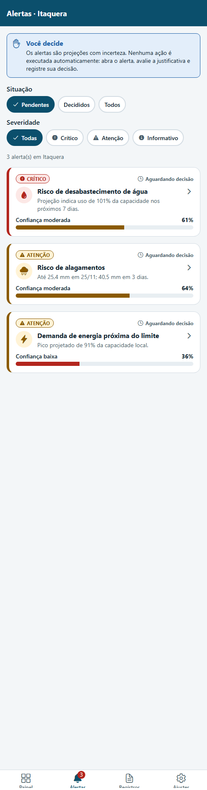
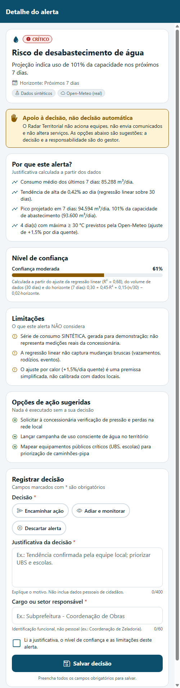
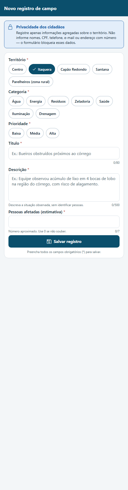
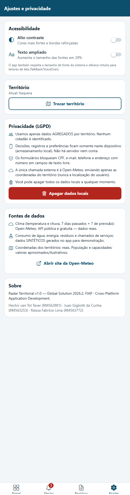

# Radar Territorial — Painel de Inteligência Territorial

> **Global Solution 2026.2 · FIAP · Ciência da Computação (2º ano, turma de fevereiro)**
> Disciplina: **Cross-Platform Application Development**

App mobile em **React Native (Expo + TypeScript)** para **gestores públicos**. Ele antecipa problemas que afetam a qualidade de vida de bairros urbanos e de uma comunidade rural: consumo de água e energia, clima local, resíduos e demanda por serviços públicos.

O app **apoia a decisão humana e não automatiza decisões de alto impacto**. Cada alerta preditivo mostra **justificativa**, **nível de confiança** (com a fórmula usada) e **limitações**. Quem decide é sempre o gestor, e a decisão fica registrada em um histórico auditável.

---

## Integrantes

| Nome completo | RM |
|---|---|
| Hector van Tol Taver | RM562881 |
| Juan Gigliotti da Cunha | RM563253 |
| Raissa Fabrício Lima | RM563772 |

### Sobre os commits deste repositório

O grupo combinou **dividir as Global Solutions do semestre entre os integrantes**. Cada pessoa ficou responsável pelo desenvolvimento de uma GS diferente, em vez de os três trabalharem juntos em todas. **Esta GS de Cross-Platform ficou sob responsabilidade de Juan Gigliotti da Cunha**, por isso o histórico de commits tem apenas o autor dele. A divisão foi um acordo interno da equipe, e os três integrantes respondem pela entrega.

---

## Telas

| Painel | Alertas | Detalhe e decisão | Registro de campo | Ajustes e privacidade |
|---|---|---|---|---|
|  |  |  |  |  |

---

## Funcionalidades

- **Painel (dashboard)** do território selecionado:
  - resumo de alertas por severidade;
  - prioridades do dia;
  - indicadores do dia (água, energia, resíduos e chamados) com variação contra a semana anterior;
  - previsão do tempo de 7 dias (API real);
  - gráfico de **tendência + projeção de 7 dias + linha de capacidade**;
  - barras de demanda por serviços que destacam anomalias.
- **Alertas preditivos explicáveis**, cada um com severidade, justificativa calculada, confiança (valor, nível e método), limitações, fontes de dados e opções de ação sugeridas:
  - risco de desabastecimento de água;
  - sobrecarga da rede elétrica;
  - coleta de resíduos acima da capacidade;
  - risco de alagamentos;
  - onda de calor;
  - pico atípico de chamados (zeladoria, saúde, iluminação, drenagem).
- **Decisão do gestor (human-in-the-loop):**
  - formulário validado: tipo de decisão, ação a encaminhar, justificativa, cargo/setor e confirmação de leitura das limitações;
  - o app **não executa nenhuma ação**, só registra a decisão;
  - a decisão pode ser revisada depois.
- **Histórico de decisões**, que funciona como trilha de auditoria.
- **Registros de campo:** observações da equipe local, com formulário validado. Registros recentes da mesma categoria **aumentam a confiança** dos alertas relacionados (até +10 p.p.), e isso aparece na justificativa.
- **Troca de território:** 4 bairros de São Paulo e 1 comunidade rural (Parelheiros).
- **Ajustes:**
  - alto contraste;
  - texto ampliado;
  - explicação de privacidade (LGPD);
  - fontes de dados;
  - botão para apagar todos os dados locais.

---

## Requisitos técnicos atendidos

| Requisito | Onde está |
|---|---|
| React Native | Expo SDK 58 + TypeScript (`App.tsx`, `src/`) |
| Navegação entre telas | React Navigation: abas inferiores + pilha + modal + deep links (`src/navigation/RootNavigator.tsx`) |
| Gerenciamento de estado | Context API + `useReducer`, com dados derivados via `useMemo` (`src/context/AppContext.tsx`) |
| Consumo de APIs | Open-Meteo, com timeout, tratamento de erro, estado de carregamento, *pull-to-refresh* e fallback para cache (`src/services/weatherApi.ts`) |
| Persistência de dados | AsyncStorage: preferências, decisões, registros de campo e cache do clima (`src/services/storage.ts`) |
| Formulários com validação | Decisão do gestor e registro de campo, com erros por campo, contador de caracteres e bloqueio de dados pessoais (`src/utils/validation.ts`, `src/screens/AlertDetailScreen.tsx`, `src/screens/NewReportScreen.tsx`) |
| Componentes reutilizáveis com identidade visual própria | Tokens de design e componentes próprios: `Card`, `Banner`, `Button`, `KpiCard`, `SeverityBadge`, `ConfidenceMeter`, `AlertCard`, `TextField`, `ChipGroup`, `ToggleRow` e gráficos SVG próprios `LineChart`, `BarList`, `WeatherStrip` (`src/components/`, `src/theme/tokens.ts`) |
| Acessibilidade | Veja abaixo |
| Privacidade dos cidadãos | Veja abaixo |

### Acessibilidade

- `accessibilityLabel`, `accessibilityRole` e `accessibilityState` em botões, chips (radio), switches, checkbox, barras de progresso e cards.
- Os gráficos têm uma **descrição textual completa** para leitores de tela (TalkBack/VoiceOver).
- Severidade **nunca é indicada só por cor**: sempre há ícone e texto.
- **Modo alto contraste** e **texto ampliado (+20%)**, além de respeitar a escala de fonte do sistema.
- Áreas de toque de no mínimo 48 dp. Erros de formulário são anunciados (`accessibilityLiveRegion`).

### Privacidade (LGPD: minimização e finalidade)

- O app usa **apenas dados agregados por território**. Nenhum cidadão é identificado.
- Os campos de texto livre **bloqueiam CPF, e-mail, telefone e endereço com número**.
- O responsável pela decisão é identificado por **cargo/setor**, não por dado pessoal.
- Tudo fica **somente no dispositivo** (sem servidor nem conta), e o usuário pode **apagar todos os dados**.
- A única chamada externa (Open-Meteo) envia só as **coordenadas do território**, nunca a localização do usuário.

---

## Fontes de dados

| Dado | Fonte | Tipo |
|---|---|---|
| Temperatura máx./mín., chuva e probabilidade de chuva (7 dias passados + 7 de previsão) | [Open-Meteo Forecast API](https://open-meteo.com/) (pública, gratuita, sem chave) | **Real** |
| Coordenadas dos territórios | Coordenadas geográficas públicas dos bairros | Real |
| Consumo de água (m³/dia), energia (MWh/dia), resíduos (t/dia) e chamados por categoria | Gerador próprio e determinístico (`src/data/synthetic.ts`) | **Sintético** |
| População, capacidades de abastecimento/rede/coleta, vulnerabilidade de drenagem | Valores aproximados e ilustrativos (`src/data/regions.ts`) | Sintético |

Os dados sintéticos levam em conta população, tendência, sazonalidade semanal e ruído, e alguns cenários têm picos injetados de propósito. Eles são **determinísticos por território e dia**, o que mantém os alertas estáveis e as decisões rastreáveis. O app marca os dados sintéticos como tal na interface.

---

## Como os alertas são calculados

Os modelos são **simples e auditáveis**, escolhidos de propósito no lugar de "caixas-pretas":

| Alerta | Método | Confiança |
|---|---|---|
| Água, energia e resíduos | Regressão linear sobre 30 dias, projeção de 7 dias × fator climático (água: +1,5% por dia ≥ 30 °C; energia: +2% por °C acima de 28 °C), comparada à capacidade (≥ 82% informativo, ≥ 90% atenção, ≥ 100% crítico) | `0,30 + 0,45·R² + 0,15·(n/30) − 0,02·horizonte` |
| Chuva / alagamento | Maior acumulado diário e maior acumulado em 3 dias da previsão, ajustados pela vulnerabilidade de drenagem do território | Probabilidade de chuva da Open-Meteo × decaimento por dia de antecedência |
| Calor | Sequência de dias com máxima ≥ 32 °C, ou máxima ≥ 35 °C | `0,85 − 0,07·dias de antecedência` |
| Demanda por serviços | z-score dos últimos 3 dias contra a linha de base de 27 dias, ajustado por dia útil/fim de semana (z ≥ 2,5 e excesso ≥ 25%) | `0,45 + 0,05·(z − 2,5)`, limitada a 0,75 |

Registros de campo recentes da mesma categoria somam até +10 p.p. de confiança. O painel e os alertas usam a **mesma função de projeção** (`projectMetric`), então os números sempre batem.

---

## Limitações

- **Os dados de consumo e de demanda são sintéticos.** Os alertas desses temas demonstram o fluxo de decisão e não refletem a situação real dos bairros.
- A regressão linear não captura rupturas como vazamentos, rodízios, eventos ou feriados.
- Os fatores climáticos (elasticidades) são **premissas não calibradas** com dados locais.
- A previsão da Open-Meteo vem de um modelo em grade: chuvas convectivas localizadas e ilhas de calor podem escapar dela.
- Vulnerabilidade de drenagem e capacidades são classificações ilustrativas, **não mapas oficiais**. O app não substitui avisos da Defesa Civil.
- Sem internet, os alertas de clima usam a última previsão salva (com data indicada). Se nunca houve conexão, esses alertas ficam desativados e o app avisa.
- Os dados ficam só no aparelho: não há sincronização entre gestores nem backend.

---

## Como executar

Pré-requisitos: **Node.js 20+** e o app **Expo Go** no celular (Android ou iOS), atualizado.

```bash
git clone https://github.com/GP16-2CCR/GS2-CROSS-PLATFORM-APPLICATION-DEVELOPMENT.git
cd GS2-CROSS-PLATFORM-APPLICATION-DEVELOPMENT
npm install
npx expo start
```

- **Celular:** leia o QR Code com o Expo Go (Android) ou com a câmera (iOS). Celular e computador precisam estar na mesma rede. Se a rede bloquear, use `npx expo start --tunnel`.
- **Navegador (opcional):** pressione `w` no terminal do Expo.
- **Verificações:** `npx tsc --noEmit` (tipagem) e `npx expo-doctor` (dependências).

---

## Estrutura

```
App.tsx                      # Providers + splash de carregamento
src/
  analytics/                 # estatística (regressão, z-score) e motor de alertas explicáveis
  components/                # componentes reutilizáveis + gráficos SVG próprios
  context/AppContext.tsx     # estado global (Context + useReducer) e persistência
  data/                      # territórios e gerador de dados sintéticos
  navigation/                # abas, pilha, tipos e deep links
  screens/                   # Painel, Alertas, Detalhe/Decisão, Registros, Novo registro, Território, Ajustes
  services/                  # API Open-Meteo e AsyncStorage
  theme/tokens.ts            # identidade visual, alto contraste, escala tipográfica
  utils/                     # formatação pt-BR e validações (incl. privacidade)
docs/ROTEIRO_DEMO.md         # roteiro da demonstração na apresentação
```

## Demonstração

A demonstração será feita **ao vivo na apresentação da Global Solution**. O passo a passo sugerido está em [`docs/ROTEIRO_DEMO.md`](docs/ROTEIRO_DEMO.md).
